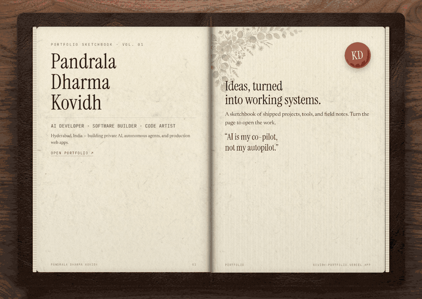
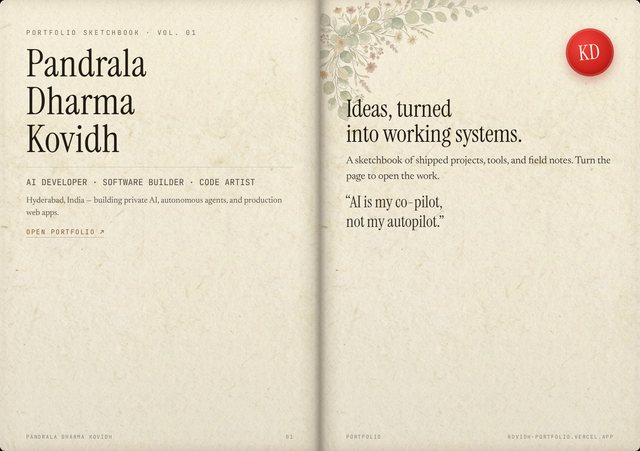
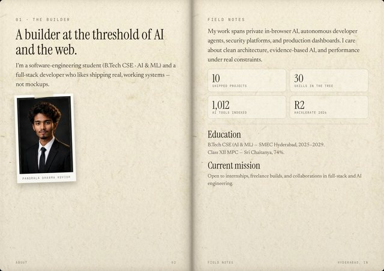
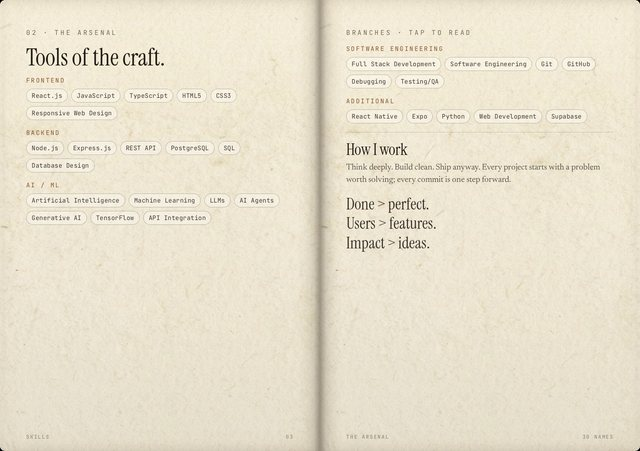
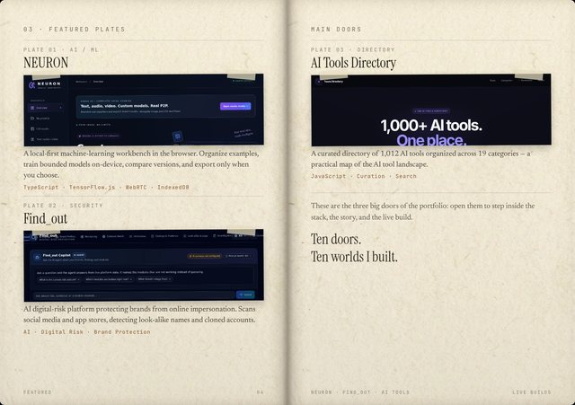
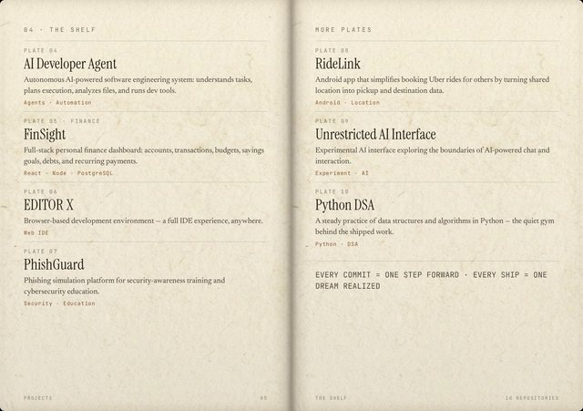
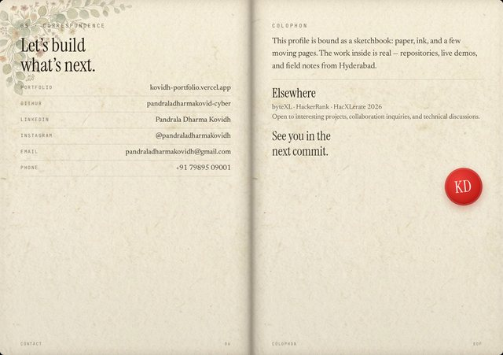

  

# Pandrala Dharma Kovidh

**AI Developer · Software Builder · Code Artist**  
Hyderabad, India — building private AI, autonomous agents, and production web apps.

 

  

 

> This profile is bound as a sketchbook. The banner above is a real page turn from the live book.  
> **Open it, drag a page, click a plate — every link opens.**

---

## 📖 How to read this book

| Action | What happens |
|---|---|
| **Drag / click a page** | The paper curls and turns with spring physics |
| **Click a project plate** | Opens a detail card with live demo + source |
| **Click a contact line** | Opens the link, mail, or phone |
| **Read** | High-contrast readable text of the current plate |
| **Loupe** | 2.3× magnifier for fine print |
| **← / → · Home / End** | Turn plates, jump to cover / colophon |
| **+ / − / double-click** | Zoom the book |

### Plate index

---

## 01 · The Builder

I’m **Pandrala Dharma Kovidh**, a software-engineering student (**B.Tech CSE · AI & ML**) and full-stack developer who likes shipping real, working systems — not mockups.

My work spans **private in-browser AI**, **autonomous developer agents**, **security platforms**, and **production dashboards**. I care about clean architecture, evidence-based AI, and performance under real constraints.

- 🎓 **B.Tech CSE (AI & ML)** — SMEC Hyderabad, 2025–2029
- 🏫 **Class XII MPC** — Sri Chaitanya, 74%
- 🏁 **HacXLerate 2026** — national Round 2
- 📍 Hyderabad, India
- 🎯 **Current mission:** internships, freelance builds, and collaborations in full-stack and AI engineering

> “AI is my co-pilot, not my autopilot.”

---

## 02 · The Arsenal

| Branch | Tools |
|---|---|
| **Frontend** | React.js · JavaScript · TypeScript · HTML5 · CSS3 · Responsive Web Design |
| **Backend** | Node.js · Express.js · REST API · PostgreSQL · SQL · Database Design |
| **AI / ML** | Artificial Intelligence · Machine Learning · LLMs · AI Agents · Generative AI · TensorFlow · API Integration |
| **Engineering** | Full Stack Development · Software Engineering · Git · GitHub · Debugging · Testing/QA |
| **Additional** | React Native · Expo · Python · Web Development · Supabase |

---

## 03 · Featured Plates

<table>
<tr>
<td width="33%" valign="top">

### 🧠 NEURON
A local-first machine-learning workbench in the browser. Organize examples, train bounded models on-device, compare versions, and export only when you choose.  
`TypeScript · TensorFlow.js · WebRTC · IndexedDB`

[Live demo](https://neuron-drab.vercel.app) · [Source](https://github.com/pandraladharmakovid-cyber/NEURON)

</td>
<td width="33%" valign="top">

### 🔍 Find_out
AI digital-risk platform protecting brands from online impersonation. Scans social media and app stores, detecting look-alike names and cloned accounts.  
`AI · Digital Risk · Brand Protection`

[Live demo](https://findout-henna.vercel.app) · [Source](https://github.com/pandraladharmakovid-cyber/Find_out)

</td>
<td width="33%" valign="top">

### 🧰 AI Tools Directory
A curated directory of **1,012 AI tools** across **19 categories** — a practical map of the AI tool landscape.  
`JavaScript · Curation · Search`

[Live demo](https://aitoolsdirectory.bytexl.live/) · [Source](https://github.com/pandraladharmakovid-cyber/ai-tools-directory)

</td>
</tr>
</table>

---

## 04 · The Shelf — all 10 repositories

| # | Plate | What it is | Links |
|---|---|---|---|
| 01 | **NEURON** | Local-first browser ML workbench | [demo](https://neuron-drab.vercel.app) · [repo](https://github.com/pandraladharmakovid-cyber/NEURON) |
| 02 | **Find_out** | AI brand impersonation / digital-risk platform | [demo](https://findout-henna.vercel.app) · [repo](https://github.com/pandraladharmakovid-cyber/Find_out) |
| 03 | **AI Tools Directory** | 1,012 tools · 19 categories | [demo](https://aitoolsdirectory.bytexl.live/) · [repo](https://github.com/pandraladharmakovid-cyber/ai-tools-directory) |
| 04 | **AI Developer Agent** | Autonomous software-engineering agent | [demo](https://ai-agent-developer.vercel.app) · [repo](https://github.com/pandraladharmakovid-cyber/Ai-agent-developer) |
| 05 | **FinSight** | Full-stack personal finance dashboard | [demo](https://finsight-gamma-three.vercel.app/) · [repo](https://github.com/pandraladharmakovid-cyber/Finsight) |
| 06 | **EDITOR X** | Browser-based IDE | [demo](https://editor-x-seven.vercel.app) · [repo](https://github.com/pandraladharmakovid-cyber/editor-x) |
| 07 | **PhishGuard** | Phishing simulation / security awareness | [demo](https://phishing-simulation-tool.bytexl.live/) · [repo](https://github.com/pandraladharmakovid-cyber/phishguard-phishing-simulation) |
| 08 | **RideLink** | Book Uber rides for others from shared location | [repo](https://github.com/pandraladharmakovid-cyber/book-ride-for-others) |
| 09 | **Unrestricted AI Interface** | Experimental AI chat interface | [repo](https://github.com/pandraladharmakovid-cyber/unrestricted-ai-interface) |
| 10 | **Python DSA** | Data structures & algorithms practice | [repo](https://github.com/pandraladharmakovid-cyber/py-dsa-) |

---

## 05 · Metrics

  

  

---

## 06 · The Journey

  

 

`EVERY COMMIT = ONE STEP FORWARD · EVERY BUG = ONE LESSON · EVERY SHIP = ONE DREAM REALIZED`

---

## 07 · Philosophy

| 💡 Think | 🔨 Build | 🚀 Ship |
|---|---|---|
| Research deeply. Question everything. Prototype fast. | Code clean. Scale smart. Debug relentlessly. | Done > perfect. Users > features. Impact > ideas. |
| Every project starts with a problem worth solving. | Architecture matters. Details matter. Ship anyway. | Nothing is real until it’s live and used. |

---

## 08 · Correspondence

**Let’s build what’s next.**  
Open to interesting projects, collaboration inquiries, and technical discussions.

  

[Résumé](https://app.bytexl.ai/resumes/shared/611026827939610b4d9529c4) · [byteXL](https://app.bytexl.ai/@pandraladharmakovidh) · [HackerRank](https://www.hackerrank.com/profile/pandraladharmak1)

 

---

Bound as a sketchbook · paper, ink, and a few moving pages · see you in the next commit.

 

